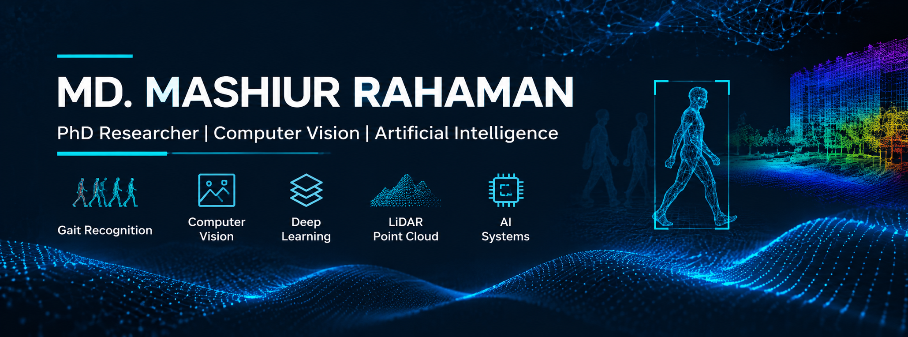

  

---

### PhD Researcher | Understanding Human Motion | *Building trust in AI*

Welcome to my GitHub profile! I’m a PhD candidate in **Control Science and Engineering** at **Central South University** in the **Intelligent Science and Technology Lab**. I explore how intelligent systems see, recognize, and understand people—from the way we walk to the 3D signals we leave behind.

My research brings together **Biometric recognition**, **LiDAR point-cloud analysis**, **3D Computer Vision**, and **Explainable AI**. I’m interested in what vision models learn, why they fail, and how we can make them more reliable in real-world conditions.

Alongside biometrics, I explore **Biomedical AI**, **Medical Image Analysis**, and **Multimodal Learning—Connecting Computational** research with human-centered applications.

## 🔬 Research Interests

- Gait Recognition and Human Identification
- Computer Vision and Pattern Recognition
- LiDAR Point Cloud Processing
- Deep Learning and Neural Networks
- Explainable Artificial Intelligence (XAI)
- Multimodal Learning and Data Fusion
- Biometric Recognition

## 🧬 Interdisciplinary Research Interests

- Biomedical Artificial Intelligence
- Medical Image Analysis
- AI-driven Healthcare Applications
- Human-Centered Intelligent Systems

## 🛠️ Technical Skills & Tools

### Programming

### Programming Languages

  
  
  
  
  
  
  
  

### AI & Computational Research

### AI & Computational Research

  
  
  
  
  
  
  
  
  
  
  
  
  
  

### Research & Development

- Gait Recognition and Human Identification
- Biometric Recognition and Information Retrieval
- LiDAR-based Human Recognition
- Point Cloud Processing and Analysis
- Deep Learning Model Development
- Medical Image Analysis
- Biomedical AI Applications
- Algorithm Design and Optimization
- Experimental Validation and Performance Evaluation
- Reproducible Research and Open-Source Development

## 📊 GitHub Statistics

  
  

## 📚 Academic Profiles
For my complete publication history and citation information:
- [Google Scholar](https://scholar.google.com/citations?user=tv9q59wAAAAJ)
- [ResearchGate](https://www.researchgate.net/profile/Md-Rahaman-160)
- [Personal Academic Website](https://mashiur-rahaman.netlify.app/)

## 📚 Research Publications & Academic Contributions

### 🎤 Accepted Conference Paper

- **IEEE 3rd International Conference on Computing, Applications and Systems (COMPAS 2026)**
  - **Status**: Accepted
  - **Venue**: University of Dhaka, Bangladesh
  - **Date**: October 9–10, 2026

### 📝 Journal Manuscripts Under Review

- **IEEE Transactions on Biometrics, Behavior, and Identity Science (IEEE T-BIOM)**
  - **Status**: Under Review

- **Pattern Recognition Letters**
  - **Status**: Under Review

## 🚀 Research & Projects

My research focuses on developing intelligent computational methods and practical AI solutions across biometric recognition, computer vision, and interdisciplinary applications.

### 🔹 Gait Recognition & Biometric Intelligence
- Human gait recognition and identification
- LeaderGate and Gate Recognition research
- Deep learning-based biometric identification
- Robust recognition under challenging conditions

### 🔹 LiDAR & 3D Vision
- LiDAR-based human recognition
- 3D point cloud processing
- Point cloud feature extraction and analysis
- Deep learning for 3D recognition

### 🔹 Explainable & Trustworthy AI
- Explainable Artificial Intelligence (XAI)
- Interpretable deep learning models
- Reliable and transparent recognition systems

### 🔹 Biomedical AI & Healthcare
- Biomedical Artificial Intelligence
- Medical Image Analysis
- AI-driven Healthcare Applications
- Human-Centered Intelligent Systems

### 🔹 Multimodal Intelligent Systems
- Multimodal learning and data fusion
- Computer vision and pattern recognition
- Intelligent recognition systems

## 🤝 Research Collaboration

I am open to interdisciplinary research collaborations with researchers, academics, and professionals working in:

- Biometrics, Gait Recognition, and Computer Vision
- Biomedical AI and Medical Image Analysis
- AI-driven Healthcare Applications
- Human-Centered Intelligent Systems
- Digital Healthcare

I welcome opportunities to exchange research ideas, collaborate on innovative projects, develop joint research, and contribute to interdisciplinary publications.

If our research interests align, feel free to connect with me! **Email**: mashiur.scholar@gmail.com

**Md. Mashiur Rahaman**  
*Researcher | Computer Vision & Patter  recognition | Biometric Identification*

[Google Scholar](https://scholar.google.com/citations?user=tv9q59wAAAAJ) · [ResearchGate](https://www.researchgate.net/profile/Md-Rahaman-160) · [Website](https://mashiur-rahaman.netlify.app/)
